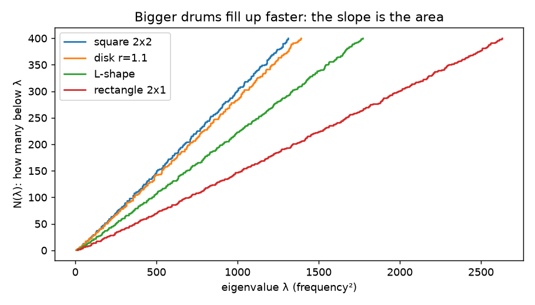

# 01 · The drum

> Can one hear the shape of a drum? (Kac, 1966)

## What the code shows

`uv run drum.py` computes the lowest 400 frequencies of four drums and then "listens" to each one using only those numbers:

| shape | area (true → heard) | perimeter (true → heard) | corner constant (theory → heard) |
|---|---|---|---|
| square 2×2 | 4.00 → 4.04 | 8.00 → 7.99 | 0.250 → 0.241 |
| disk r=1.1 | 3.80 → 3.83 | 6.91 → 6.91 | 0.167 → 0.166 |
| L-shape | 3.00 → 3.05 | 8.00 → 8.01 | 0.278 → 0.271 |
| rectangle 2×1 | 2.00 → 2.03 | 6.00 → 6.02 | 0.250 → 0.245 |

From sound alone you can hear the **area**, the **perimeter**, and even something about the **corners**. But not the full shape: Gordon, Webb and Wolpert (1992) built two different drums that ring at exactly the same frequencies.

## In my own words

<!-- Write these yourself. Short is fine. This part is the point of the notebook. -->

**Why does a bigger drum have more low notes?**

**Why can the heat trace hear the perimeter when counting eigenvalues directly couldn't?** (Try swapping `hear()` for a straight fit of N(λ) and see what breaks.)

**How is this like EEG?** Scalp voltages are the "sound", the sources inside the head are the "shape". What can the scalp tell you, and what can't it?

## My experiment

<!-- Change one thing and report what happened. Ideas: a triangle, a drum with a hole, a coarser grid (H = 0.05), fewer eigenvalues (K = 50). -->

## What I still don't know

<!-- This becomes the seed for entry 02. -->

## Phrases I needed

<!-- 3-5 English phrases you had to look up while writing. Then: ody words add "phrase | 뜻" -->

-
