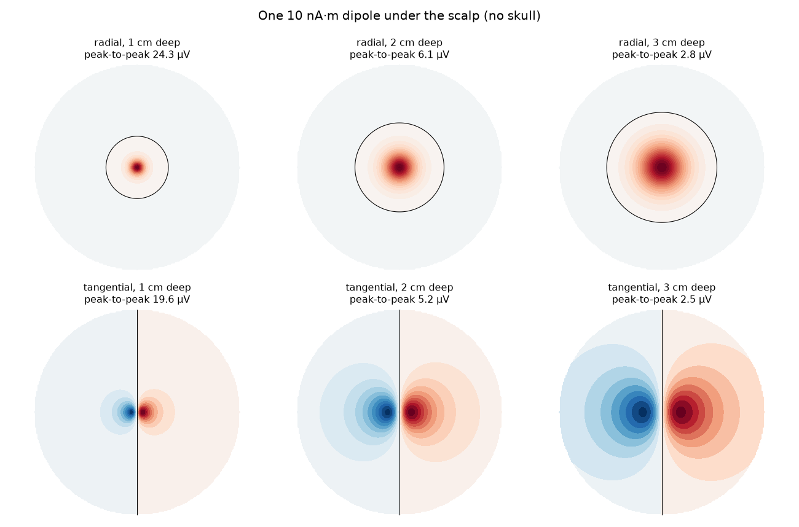

# 02 · Where EEG comes from

> How do neurons make a voltage you can measure on the scalp?

## What the code shows

`uv run eeg.py` puts one 10 nA·m current dipole under a 9 cm spherical scalp (uniform conductor, no skull yet) and maps the voltage on the surface:

| dipole | depth | peak-to-peak | strongest point |
|---|---|---|---|
| radial (pointing out) | 1 cm | 24.3 µV | right above it |
| radial | 2 cm | 6.2 µV | right above it |
| radial | 3 cm | 2.8 µV | right above it |
| tangential (lying flat) | 1 cm | 19.6 µV | 5° to the side |
| tangential | 2 cm | 5.2 µV | 10° to the side |
| tangential | 3 cm | 2.5 µV | 16° to the side |

- Twice as deep → about a quarter of the voltage, and the pattern spreads wider.
- A radial source shows up as one bump directly above it. A tangential source shows up as a +/− pair, and the spot directly above it reads **zero**.
- 10 nA·m at roughly 0.5 pA·m per pyramidal neuron is about **20,000 neurons firing together**.

## In my own words

<!-- Write these yourself. Short is fine. -->

**Why does a tangential dipole read zero right above itself?**

**Why does depth cost so much (and blur the picture)?**

**What does "no skull" get wrong? Guess before entry 03.**

**Link back to 01:** two different source setups could produce the same scalp map. Can you build one?

## My experiment

<!-- Ideas: two dipoles pointing opposite ways 1 cm apart (do they cancel?), a dipole at 45°, a 100 nA·m source 5 cm deep. -->

## What I still don't know

<!-- This becomes the seed for entry 03, and your morning "chew on this" question. -->

## Phrases I needed

<!-- 3-5 English phrases you looked up. Then: ody words add "phrase | 뜻" -->

-

## Sources

- Murakami S, Okada Y (2006). Contributions of principal neocortical neurons to magnetoencephalography and electroencephalography signals. *J Physiol* 575(3). Per-neuron dipole moment estimate; check before quoting numbers.
- Nunez PL, Srinivasan R. *Electric Fields of the Brain: The Neurophysics of EEG* (2nd ed., 2006). Chapters on current dipoles in volume conductors.
